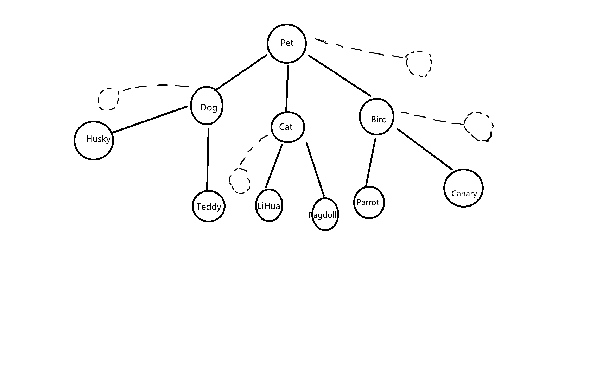

# 章节三

# 3.1

## 类 与 对象

#### (1) 类是一个模板，它包含了某一类事物的所有的属性和行为。比如可以定义一个dog类，它包含了dog的如名字，品种，毛色，大小等属性，还包含了如吃饭，睡觉，奔跑等行为。

#### (2) 对象是类的一个实例，类是指的某一类事物，而对象则是类中的某个具体的事物。

#### (3) 属性即类中的成员变量，行为即类中的方法

##### (4)

```java
package YOLO.SpiritDog;

public class SpiritDog {
    String name;
    int age;
    int hunger;
    String color;
    String kind;

    public SpiritDog() {
    }

    public SpiritDog(String name, int age, int hunger, String color, String kind) {
        this.name = name;
        this.age = age;
        this.hunger = hunger;
        this.color = color;
        this.kind = kind;
    }

    public String getName() {
        return name;
    }

    public void setName(String name) {
        this.name = name;
    }

    public int getAge() {
        return age;
    }

    public void setAge(int age) {
        this.age = age;
    }

    public int getHunger() {
        return hunger;
    }

    public void setHunger(int hunger) {
        this.hunger = hunger;
    }

    public String getColor() {
        return color;
    }

    public void setColor(String color) {
        this.color = color;
    }

    public String getKind() {
        return kind;
    }

    public void setKind(String kind) {
        this.kind = kind;
    }

    public void eat(){
        System.out.println(name + "在吃饭");
    }

    public void sleep(){
        System.out.println(name + "在睡觉");
    }

    public void play(){
        System.out.println(name + "在玩耍");
    }

    public static void main(String[] args) {
        SpiritDog dog = new SpiritDog("kangkang",3,100,"black","tidy");
        System.out.println("名字：" + dog.getName());
        System.out.println("年龄：" + dog.getAge());
        System.out.println("颜色：" + dog.getColor());
        System.out.println("品种：" + dog.getKind());
        System.out.println("饥饿值：" + dog.getHunger());
        dog.eat();
        dog.play();
        dog.sleep();

    }
}

```

# 3.2 封装 继承 多态

# 封装

#### 1.构建守护结界

#### (2)封装能将对象的属性和实现细节隐藏起来，外部只能通过特定方法来访问和操作对象。这样就防止了外部代码随意修改对象的内部数据，保障了数据的安全性。同时系统中的各个模块通过封装，对外只暴露必要的方法，模块内部的变化不会轻易影响到其他模块。这使得模块之间的依赖关系减弱，当需要对某个模块进行修改或升级时，只要保持方法不变，就不会对整个系统的其他部分造成大的影响，增强了系统的可维护性和可控性。封装规定了外部与对象交互的方式，所有的操作都必须通过预先定义好的方法进行，减少了因不规范操作而引发的安全问题，让系统的运行更加可控。

#### 2.规范的能量交换

#### 私有化成员变量

```java
    private String name;
    private int age;
    private int hunger;
    private String color;
    private String kind;
```

#### set和get方法

```java
	public String getName() {
        return name;
    }

    public void setName(String name) {
        this.name = name;
    }

    public int getAge() {
        return age;
    }

    public void setAge(int age) {
        this.age = age;
    }

    public int getHunger() {
        return hunger;
    }

    public void setHunger(int hunger) {
        this.hunger = hunger;
    }

    public String getColor() {
        return color;
    }

    public void setColor(String color) {
        this.color = color;
    }

    public String getKind() {
        return kind;
    }

    public void setKind(String kind) {
        this.kind = kind;
    }
```

#### 3. `static`

##### (2) 

```java
package YOLO.SpiritDog;

public class SpiritDog {
    private String name;
    private int age;
    private int hunger;
    private String color;
    private String kind;
    private static int count;//统计创建的对象数量
    public SpiritDog() {
        count ++ ;
    }

    public SpiritDog(String name, int age, int hunger, String color, String kind) {
        count ++ ;
        this.name = name;
        this.age = age;
        this.hunger = hunger;
        this.color = color;
        this.kind = kind;
    }

    public String getName() {
        return name;
    }

    public void setName(String name) {
        this.name = name;
    }

    public int getAge() {
        return age;
    }

    public void setAge(int age) {
        this.age = age;
    }

    public int getHunger() {
        return hunger;
    }

    public void setHunger(int hunger) {
        this.hunger = hunger;
    }

    public String getColor() {
        return color;
    }

    public void setColor(String color) {
        this.color = color;
    }

    public String getKind() {
        return kind;
    }

    public void setKind(String kind) {
        this.kind = kind;
    }

    public void eat(){
        System.out.println(name + "在吃饭");
    }

    public void sleep(){
        System.out.println(name + "在睡觉");
    }

    public void play(){
        System.out.println(name + "在玩耍");
    }

    public static void main(String[] args) {
        SpiritDog dog = new SpiritDog("kangkang",3,100,"black","tidy");
        System.out.println("名字：" + dog.getName());
        System.out.println("年龄：" + dog.getAge());
        System.out.println("颜色：" + dog.getColor());
        System.out.println("品种：" + dog.getKind());
        System.out.println("饥饿值：" + dog.getHunger());
        dog.eat();
        dog.play();
        dog.sleep();

    }
}

```

# 继承

### 1.绘制生命之树

##### (1)子类不能使用父类的构造方法，但可以使用父类的所有成员变量（私有成员变量要靠get和set方法来使用），以及未被final,static,private修饰的成员方法（即虚方法表中的方法）

##### (2) 子类中可以写自己特有的成员方法或者根据需求重写父类中的方法

##### (3) super即父类的地址值，this是方法调用者的地址值（即当前子类地址值）。在子类构造函数中，会默认含有一个父类的空参构造（即super(）），也可以自己在开头写一个有参构造super（参数）。

```java
public class Dog extends Animal{
    public Dog() {
    }

    public Dog(int age, String color) {
        super(age, color);
    }

}
```

##### 也可以通过this和super来初始化，此时需要其中一个构造方法中有super

```java
public class Dog extends Animal{
    public Dog() {
        this.Dog(1,"black");
    }

    public Dog(int age, String color) {
        super(age, color);
    }

}
```

#### (4)

-  抽象类是一种不能被实例化的类，它是为了表示一些抽象的概念而存在的，类中可以包含抽象方法（只有方法声明，没有方法实现的方法）和普通方法。

- 可以将相同但实现方式不同的行为定义为抽象方法（如狗吃骨头，猫吃鱼），在子类中强制重写这种方法，这样可以使方法名统一。

#### （5）继承图



```java
//Pet类
public class Pet {
    private int age;
    private String color;
	//......
}
/*-----------------------------------------------------*/ 
//Dog类
public class Dog extends Pet {
	//......
}
/*-----------------------------------------------------*/ 
//Cat类
public class Cat extends Pet {
	//......
}
/*-----------------------------------------------------*/ 
//Bird类
public class Bird extends Pet {
	//......
}
/*-----------------------------------------------------*/ 
//Husky类
public class Husky extends Dog {
	//......
}
/*-----------------------------------------------------*/ 
//Teddy类
public class Teddy extends Dog {
	//......
}
/*-----------------------------------------------------*/ 
//LiHua类
public class LiHua extends Cat {
	//......
}
/*-----------------------------------------------------*/ 
//Ragdoll类
public class Ragdoll extends Cat {
	//......
}
/*-----------------------------------------------------*/ 
//Parrot类
public class Parrot extends Bird {
	//......
}
/*-----------------------------------------------------*/ 
//Canary类
public class Canary extends Bird {
	//......
}
```


# 多态

### 接口

##### (2) 抽象类用于继承关系（将父类写成抽象类），接口用于实现关系（接口是一种规则）

###  能力接口实现

```java
//swimmable接口
public interface Swimmable {
    public abstract void swim();
}

//flyable接口
public interface Flyablee {
    public abstract void flyable();
}

//Healyable接口
public interface Healyable {
    public abstract void healyable();
}


//Frog实现接口
public class Frog extends Animal implements Swim,Healable{
    public Frog() {
    }

    public Frog(String name, int age) {
        super(name, age);
    }

    @Override
    public void eat() {
        System.out.println("青蛙在吃虫子");
    }

    @Override
    public void swim() {
        System.out.println("青蛙在游泳");
    }
    
    @Override
    public void healable() {
        System.out.println("Healable");
    }
}
//Parrot实现接口
public class Parrot extends Animal implements Flyable,Healable{
    public Parrot() {
    }

    public Parrot(String name, int age) {
        super(name, age);
    }

    @Override
    public void eat() {
        System.out.println("鹦鹉在吃东西");
    }
    
    @Override
    public void flyable() {
        System.out.println("鹦鹉在飞行");
    }
    
	@Override
    public void healable() {
        System.out.println("Healable");
    }
    
    
}

```

## 多态

#### (1)

+ 父类引用指向子类实例：将new出来的子类对象的地址赋给父类类型的变量，方便传参时统一处理

+ 方法重写：子类中必须重写父类的方法

+  接口引用指向实现类实例：将将new出来的实现类对象的地址赋给接口类型的变量，此时更据不同的实现类可以调用相应的接口能力

##### (2) `instanceof` 可用于判断当前的父类引用或接口引用具体是哪一种对象。例如

```
Animal a = new Dog();
a instanceof Dog //a是Dog则表达式为真，反之为假
```

#### (3) 补全代码

#### 祖先类

```java
package YOLO.PetStore;

public class Ancester {
    String name;
    int age;

    public Ancester() {
    }

    public Ancester(String name, int age) {
        this.name = name;
        this.age = age;
    }

    public String getName() {
        return name;
    }

    public void setName(String name) {
        this.name = name;
    }

    public int getAge() {
        return age;
    }

    public void setAge(int age) {
        this.age = age;
    }

    public void makeSound(){

    }
}

```


#### Pet

```java
package YOLO.PetStore;

public class SpiritDog extends Ancester{
    public SpiritDog() {
    }

    public SpiritDog(String name, int age) {
        super(name, age);
    }

    @Override
    public void makeSound() {
        System.out.println("汪！");
    }
}
/*---------------------------------------------*/
package YOLO.PetStore;

import Abstrat.Animal;

public class MagicCat extends Ancester{
    public MagicCat() {
    }

    public MagicCat(String name, int age) {
        super(name, age);
    }

    @Override
    public void makeSound() {
        System.out.println("喵~");
    }
}
/*---------------------------------------------*/
package YOLO.PetStore;

public class BabyDragon extends Ancester{
    public BabyDragon() {
    }

    public BabyDragon(String name, int age) {
        super(name, age);
    }

    @Override
    public void makeSound() {
        System.out.println("嗷~");
    }
}


```

#### 测试类

```java
package YOLO.PetStore;

import java.util.Random;
class PetStoreOpeningTest {
    public static void main(String[] args) {
        Random random = new Random();
        int choice = random.nextInt(3);
        Ancester newCompanion = new Ancester();
        switch (choice) {
        	case 0:
               newCompanion = new MagicCat();
               break;
            case 1:
               newCompanion = new SpiritDog();
               break;
             case 2:
               newCompanion = new BabyDragon();
               break;
         }
         if (newCompanion instanceof MagicCat) {
                System.out.println("恭喜你，获得了一只神奇的魔法猫！");
                newCompanion.makeSound();
          } else if (newCompanion instanceof SpiritDog) {
                System.out.println("恭喜你，获得了一只神奇的灵魂犬！");
                newCompanion.makeSound();
          } else {
                System.out.println("恭喜你，获得了一只神奇的幼龙！");
                newCompanion.makeSound();
          }
    }
}

```

# 3.3 内部类与设计模式

## 技巧一：内部类

### 1.四种内部类

+ #### 成员内部类：

	+ 定义：写在一个类的成员位置的类
	+ 特点：可以调用外部类的所有属性和方法，依赖外部类而存在，通过外部类对象来创建成员内部类对象
	+ 适用场景：内部类依赖与外部类而存在，是外部类的一部分。如外部类的一个组件类。

+ #### 静态内部类：

	+ 定义：用static修饰的内部类
	+ 特点：只能访问外部类的静态成员，自己可以有静态成员和非静态成员。可直接通过外部类名来访问。
	+ 适用场景：当内部类不需要访问外部类的非静态成员，且希望减少对外部类实例的依赖，或者作为工具类、与外部类有一定关联但相对独立时使用，例如外部类的静态辅助类。

+ #### 局部内部类：

	+ 定义：在方法体或代码块内部的类
	+ 特点：外部无法创建对象，只能在方法或代码块中创建对象。可以访问外部的成员以及方法内的final变量，不能被public和private修饰。
	+ 适用场景：仅在某个方法或代码块内部使用，外部不需要访问的类，比如在某个方法中处理特定问题的临时类。

+ #### 匿名内部类：

	+ 定义：没有类名的内部类，用于创建实现某个接口或继承某个类的对象。
	+ 特点：没有类名，是接口实现类或子类的对象。
	+ 适用场景：需要快速创建一个实现特定接口或继承特定类的对象，且该对象只使用一次的场景。

### 2. Builder

+ 当参数过多时，传统构造方法会有很多参数列表，调用时容易搞混参数顺序和意义。建造者模式可以通过链式调用，分步骤设置参数，更清晰易懂。
+ 对于可选参数，建造者模式能设置默认值，要更改时在更改，否则保留默认值。
+ `PetProfile` 的成员变量都是final修饰的，通过build（）方法可以一次性创建出不可变的对象。

### 3.匿名内部类

#### （1）函数式接口

+ `Runnable`是 Java 中用于表示可执行任务的函数式接口，主要用于多线程编程。
+ `Comparator`是用于对象比较的函数式接口，主要用于集合排序。

#### (2)

#### 匿名内部类

```java
package YOLO.PetStore;

import Abstrat.Animal;

import java.util.Arrays;
import java.util.Comparator;

public class Compare {
    public static void main(String[] args) {
        SpiritDog spiritDog = new SpiritDog("kk",2);
        MagicCat magicCat = new MagicCat("mm",1);
        BabyDragon babyDragon = new BabyDragon("ll",4);
        Ancester[] ancester = {spiritDog,magicCat,babyDragon};
        Arrays.sort(ancester, new Comparator<Ancester>() {
            @Override
            public int compare(Ancester o1, Ancester o2) {
                return o1.getAge() - o2.getAge();
            }
        });
        for (int i = 0; i < ancester.length; i++) {
            Ancester a = ancester[i];
            System.out.println(a.getName() + " " + a.getAge());
        }
    }

}
```

#### lambda表达式

```java
package YOLO.PetStore;

import Abstrat.Animal;

import java.util.Arrays;
import java.util.Comparator;

public class Compare {
    public static void main(String[] args) {
        SpiritDog spiritDog = new SpiritDog("kk",2);
        MagicCat magicCat = new MagicCat("mm",1);
        BabyDragon babyDragon = new BabyDragon("ll",4);
        Ancester[] ancester = {spiritDog,magicCat,babyDragon};
//        Arrays.sort(ancester, new Comparator<Ancester>() {
//            @Override
//            public int compare(Ancester o1, Ancester o2) {
//                return o1.getAge() - o2.getAge();
//            }
//        });
        Arrays.sort(ancester,(o1,o2) -> o1.getAge() - o2.getAge());
        for (int i = 0; i < ancester.length; i++) {
            Ancester a = ancester[i];
            System.out.println(a.getName() + " " + a.getAge());
        }
    }

}

```

#### 方法引用

```java
package YOLO.PetStore;

import Abstrat.Animal;

import java.util.Arrays;
import java.util.Comparator;
import java.util.function.Function;

public class Compare {
    public static void main(String[] args) {
        SpiritDog spiritDog = new SpiritDog("kk",2);
        MagicCat magicCat = new MagicCat("mm",1);
        BabyDragon babyDragon = new BabyDragon("ll",4);
        Ancester[] ancester = {spiritDog,magicCat,babyDragon};
//        Arrays.sort(ancester, new Comparator<Ancester>() {
//            @Override
//            public int compare(Ancester o1, Ancester o2) {
//                return o1.getAge() - o2.getAge();
//            }
//        });
//        Arrays.sort(ancester,(o1,o2) -> o1.getAge() - o2.getAge());
        Arrays.sort(ancester,Compare::cmp);
        for (int i = 0; i < ancester.length; i++) {
            Ancester a = ancester[i];
            System.out.println(a.getName() + " " + a.getAge());
        }
    }
    public static int cmp(Ancester a, Ancester b){
        return a.getAge() - b.getAge();
    }
}

```

#### 遇到的问题

+ `Arrays.sort()`如何使用
+ 想知道如何实现从大到小排序
+ 方法引用如何书写
+ 问题处显示for循环可被替换成增强的for

#### 解决方式

+ 在`API`中查找`Arrays.sort()`后找到使用方法
+ 猜想交换return后两数的位置可以实现从大到小排序，之后验证发现确实是这样。进一步查找了`Arrays.sort()`的背后逻辑，发现若两数之差为负则表示`o1`应在`o2`之前，为0则表示`o1`,`o2`位置相同，为正则表示`o1`应该在`o2`之后。
+ 在网上搜索后学习了方法引用的使用方法和注意事项(形参和返回值要与接口的抽象方法一致，实现的功能也要一致)
+ 学习了for循环的增强型写法（更加简洁易读）

```java
for(Ancester a : ancester){
	System.out.println(a.getName() + " " + a.getAge());
}
```

### 设计模式

> ### 单例模式

+ 概念：只有一个实例对象的类

+ 实现方式：

	+ ##### 懒汉式：

		```java
	//多线程不安全
		public SingleIns{
			private static SingleIns Instance;
			private SingleIns(){
			
			}
			public static SingleIns getInstance(){
				if(instance == null){
					instance = new SingleIns();
				}
				return instance;
			}
		}
	```

	```java
	//多线程安全
	public SingleIns{
		private static SingleIns Instance;
		private SingleIns(){
		
		}
		//加锁，但效率降低
		public static synchronized SingleIns getInstance(){
			if(instance == null){
				instance = new SingleIns();
			}
			return instance;
		}
	}
	```

	+ ##### 饿汉式

	```Java
	//常用，多线程安全，在类加载时就初始化，但没有达到延迟初始化的效果
	public SingleIns{
		private static SingleIns Instance = new SingleIns();
		private SingleIns(){
		
		}
		public static SingleIns getInstance(){
			return instance;
		}
	}
	```

	+ ##### 双重校验锁

	+ ##### 静态内部类

	+ ##### 枚举

	****

	#### InteractionManager

	```java
	package YOLO.PetStore;
	
	public class InteractionManager {
	    private static InteractionManager interaction = new InteractionManager();
	    private InteractionManager(){
	
	    }
	    public void interact(Pet a,Pet b){
	        System.out.println(a.getName() + "与" + b.getName() + "在互动");
	    }
	    public static InteractionManager getInteration(){
	        return interaction;
	    }
	}
	
	```

	#### InteractionTest

	```java
	package YOLO.PetStore;
	
	public class InteractionTest {
	    public static void main(String[] args) {
	        SpiritDog spiritDog = new SpiritDog("kk",2);
	        MagicCat magicCat = new MagicCat("mm",1);
	        BabyDragon babyDragon = new BabyDragon("ll",4);
	        InteractionManager im = InteractionManager.getInteration();
	        im.interact(spiritDog,magicCat);
	        im.interact(magicCat,babyDragon);
	    }
	
	
	}
	```

> ### 策略模式

#### Strategy接口

```java
package YOLO.PetStore;

public interface Strategy {
    public void act(Pet a,Pet b);
}
```

#### 三个实现类

```java
//玩耍
package YOLO.PetStore;

public class Play implements Strategy{
    public Play() {
    }

    @Override
    public void act(Pet a,Pet b) {
        System.out.println(a.getName() + "和" + b.getName() + "在玩耍");
    }
}
//争抢食物
package YOLO.PetStore;

public class FightForFood implements Strategy{
    public FightForFood() {
    }

    @Override
    public void act(Pet a, Pet b) {
        System.out.println(a.getName() + "和" + b.getName() + "在争抢食物");
    }
}

//魔法对决
package YOLO.PetStore;

public class MagicCompete implements Strategy{
    public MagicCompete() {
    }

    @Override
    public void act(Pet a, Pet b) {
        System.out.println(a.getName() + "和" + b.getName() + "在魔法对决");
    }
}
```

#### InteractionManager

```java
package YOLO.PetStore;

public class InteractionManager {
    private static InteractionManager interaction = new InteractionManager();
    private InteractionManager(){

    }
    //本质是接口多态
    public void interact(Pet a,Pet b,Strategy strategy){
        strategy.act(a,b);
    }
    public static InteractionManager getInteration(){
        return interaction;
    }
}
```

#### Test

```java
package YOLO.PetStore;

public class InteractionTest {
    public static void main(String[] args) {
        SpiritDog spiritDog = new SpiritDog("kk",2);
        MagicCat magicCat = new MagicCat("mm",1);
        BabyDragon babyDragon = new BabyDragon("ll",4);
        Play play = new Play();
        FightForFood fightForFood = new FightForFood();
        MagicCompete magicCompete = new MagicCompete();
        InteractionManager im = InteractionManager.getInteration();
        im.interact(spiritDog,magicCat,play);
        im.interact(magicCat,babyDragon,fightForFood);
        im.interact(babyDragon,spiritDog,magicCompete);

    }
}
```

> ### 工厂方法模式

```java
package YOLO.PetStore;
interface PPet {
    public void makeSound();
}
class SSpiritDog implements PPet{
    public void makeSound(){
        System.out.println("获得了一只SpiritDog");
    }
}
class MMagicCat implements PPet{
    public void makeSound(){
        System.out.println("获得了一只MagicCat");
    }
}
class BBabyDragon implements PPet{
    public void makeSound(){
        System.out.println("获得了一只BabyDragon");
    }
}
interface Factor{
    PPet creatPet();
}
class SSpritDogFactor implements Factor{
    @Override
    public PPet creatPet() {
        return new SSpiritDog();
    }
}
class MMgicCatFactor implements Factor{
    @Override
    public PPet creatPet() {
        return new MMagicCat();
    }
}
class BBabyDragonFactor implements Factor{
    @Override
    public PPet creatPet() {
        return new BBabyDragon();
    }
}
public class PetFactor {
    public static void main(String[] args) {
        Factor spritDogFactor = new SSpritDogFactor();
        PPet pet1 = spritDogFactor.creatPet();
        pet1.makeSound();
        Factor babyDragonFactor = new BBabyDragonFactor();
        PPet pet2 = babyDragonFactor.creatPet();
        pet2.makeSound();
        Factor mgicCatFactor = new MMgicCatFactor();
        PPet pet3 = mgicCatFactor.creatPet();
        pet3.makeSound();
    }
}
```

### 疑惑

+ 为什么工厂方法需要两个接口，为什么不直接写成一个工厂类和一个宠物类一一对应的形式
+ 如何增添宠物的属性

### 解决方式

+ 上网查找后发现工厂方法模式实际上是利用了接口多态，用一个更范围更广的接口来接收实现类对象，更加规范。

 +  如果写成一个工厂类和一个宠物类一一对应的形式，则需要这样

     ```java
     	MagicCatFactory catFactory = new MagicCatFactory();
     	MagicCat cat = catFactory.createPet(); 
     ```

     此时若新增一个宠物需要改动MagicCatFactory，MagicCat

     + 如果写成接口形式

     ```java
     Factor spritDogFactor = new SSpritDogFactor();
     PPet pet1 = spritDogFactor.creatPet();
     ```

     此时的`Factor,PPet`不需要改动，代码更加规范，更具一般性

+ 在宠物类中增加属性即可，但是如果宠物过多的话就需要在每一个类里都增加属性，非常麻烦。这个时候我想到可以利用继承关系提高代码复用性，于是将代码改成了这样

```java
package YOLO.PetStore;
class Pet {
    String name;
    int age;
    public Pet() {
    }
    public Pet(String name, int age) {
        this.name = name;
        this.age = age;
    }
    public String getName() {
        return name;
    }
    public void setName(String name) {
        this.name = name;
    }
    public int getAge() {
        return age;
    }
    public void setAge(int age) {
        this.age = age;
    }
    public void makeSound(){
    }
}
class SSpiritDog extends Pet{
    public SSpiritDog() {
    }

    public SSpiritDog(String name, int age) {
        super(name, age);
    }

    @Override
    public void makeSound(){
        System.out.println("获得了一只叫做" + name + "的" + age + "岁的SpiritDog");
    }
}
class MMagicCat extends Pet {
    public MMagicCat() {
    }

    public MMagicCat(String name, int age) {
        super(name, age);
    }

    @Override
    public void makeSound(){
        System.out.println("获得了一只叫做" + name + "的" + age + "岁的MagicCat");
    }
}
class BBabyDragon extends Pet {
    public BBabyDragon() {
    }

    public BBabyDragon(String name, int age) {
        super(name, age);
    }

    @Override
    public void makeSound(){
        System.out.println("获得了一只叫做" + name + "的" + age + "岁的BabyDragon");
    }
}
interface Factor{
    Pet createPet(String name,int age);
}
class SSpiritDogFactor implements Factor{
    @Override
    public Pet createPet(String name,int age) {
        return new SSpiritDog(name,age);
    }
}
class MMagicCatFactor implements Factor{
    @Override
    public Pet createPet(String name,int age) {
        return new MMagicCat(name,age);
    }
}
class BBabyDragonFactor implements Factor{
    @Override
    public Pet createPet(String name,int age) {
        return new BBabyDragon(name,age);
    }
}
public class PetFactor {
    public static void main(String[] args) {
        Factor spritDogFactor = new SSpiritDogFactor();
        Pet pet1 = spritDogFactor.createPet("kk",1);
        pet1.makeSound();
        Factor babyDragonFactor = new BBabyDragonFactor();
        Pet pet2 = babyDragonFactor.createPet("ll",2);
        pet2.makeSound();
        Factor mgicCatFactor = new MMagicCatFactor();
        Pet pet3 = mgicCatFactor.createPet("mm",3);
        pet3.makeSound();
    }
}
```

但是不知道是不是能这样写，发给豆包后他评价我的代码整体符合工厂方法模式的设计思想，还请改题人大佬指正。
