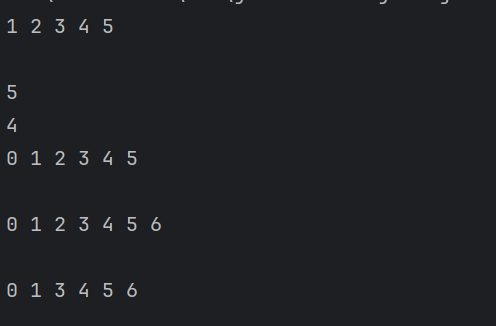

# 2.1第一关：塑造生命的基本形态——链接核心

### 2.1.1 理解链表本质及与数组的对比

- **链表本质**：链表是一种线性数据结构，由一系列节点组成，每个节点包含数据域和指向下一个节点的指针（引用）。通过指针将节点依次连接，形成链式结构。
- 与数组对比：
  - **数组**：在内存中是连续存储的，优点是可以通过索引快速随机访问元素；但缺点是插入和删除元素时，需要移动大量元素（时间复杂度为 *O*(*n*)），且数组的大小通常是固定的（静态数组），动态扩容也存在一定开销。
  - **链表**：在内存中不需要连续存储，插入和删除元素时，只需修改指针（时间复杂度为 *O*(1)，若要找到插入 / 删除位置则为 *O*(*n*)），可以动态地增减节点，灵活性更强。

### 2.1.2 实现链表操作方法

**前备工作**

```java
//定义节点
public class Node {
    int value;
    Node next;

    Node(int value) {
        this.value = value;
        this.next = null;
    }
}
//定义链表，未包括方法
public class MyLinkedList{
     private Node head;
    private int size;

    public MyLinkedList() {
        head = null;
        size = 0;
    }
}
```

 **题目要求实现的方法如下：**

```java
//尾插节点
public void add(int value) {
    Node newNode = new Node(value);
    if (head == null) {
        head = newNode;
    }
    else {
        Node current = head;
        while (current.next != null) {
            current = current.next;
        }
        current.next = newNode;
    }
    size++;
}

// 在指定索引位置插入节点
public void insert(int index, int value) {
    if (index < 0 || index > size) {
        System.out.println("行为非法");;
    }
    Node newNode = new Node(value);
    if (index == 0) {
        newNode.next = head;
        head = newNode;
    }
    else {
        Node current = head;
        for (int i = 0; i < index - 1; i++) {
            current = current.next;
        }
        newNode.next = current.next;
        current.next = newNode;
    }
    size++;
}

// 获取指定索引位置节点的值
public int get(int index) {
    if (index < 0 || index >= size) {
        System.out.println("行为非法");;
    }
    Node current = head;
    for (int i = 0; i < index; i++) {
        current = current.next;
    }
    return current.value;
}

// 删除指定索引位置的节点
public void remove(int index) {
    if (index < 0 || index >= size) {
        System.out.println("行为非法");;
    }
    if (index == 0) {
        head = head.next;
    } else {
        Node current = head;
        for (int i = 0; i < index - 1; i++) {
            current = current.next;
        }
        current.next = current.next.next;
    }
    size--;
}

// 获取链表节点个数
public int size() {
    return size;
}
```

### 2.1.3生命测试

```java
public class main {
    public static void main(String[] args) {
        MyLinkedList listTest = new MyLinkedList();
        //构造测试数据组[1,2,3,4,5]
        //generateList为构造包含元素1~n的链表，printList为打印链表数据。
        listTest.generateList(5);
        //输出测试数据组
        listTest.printList();
        //检验链表长度 预期结果：5
        System.out.println(listTest.size());
        //获取第三个节点的元素 预期结果：3
        System.out.println(listTest.get(3));
        //在第一个位置插入元素 预期结果：0 1 2 3 4 5
        listTest.insert(0, 0);
        listTest.printList();
        //尾插法 预期结果：0 1 2 3 4 5 6
        listTest.add(6) ;
        listTest.printList();
        //删除第三个位置的元素 预期结果：0 1 3 4 5 6
        listTest.remove(2);
        listTest.printList();
    }
}
```

控制台截图与预期相符



### 2.1.4反转链表

方法一：**迭代法**

```java
//不带头节点 
public Node reverse(Node head) {
        Node prev = null;
        Node current = head;
        Node next;
        while (current != null) {
            next = current.next;
            current.next = prev;
            prev = current;
            current = next;
        }
    return prev;
    }
//带头节点
public Node reverse1(Node head){
       head.next=reverse(head.next);
    return head;
}
```

方法二：**递归法**

```java
//不带头节点的递归
public Node reverse(Node head) {
    if (head == null || head.next == null) {
        return head;
    }
    Node newHead = reverse(head.next);
    head.next.next = head;
    head.next = null;
    return newHead;
}
//带头节点的递归
public Node reverse1(Node head) {
    if (head == null || head.next == null) {
        return head;
    }
    Node reversedDataHead = reverse(head.next);
    head.next = reversedDataHead;
    return head;
}
```

