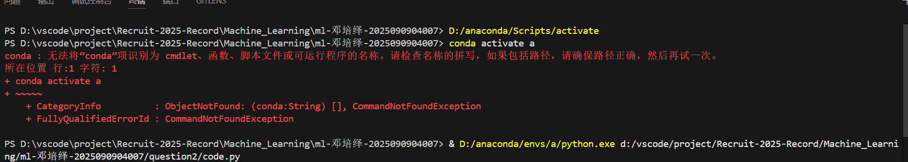
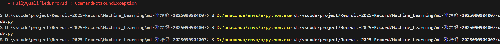
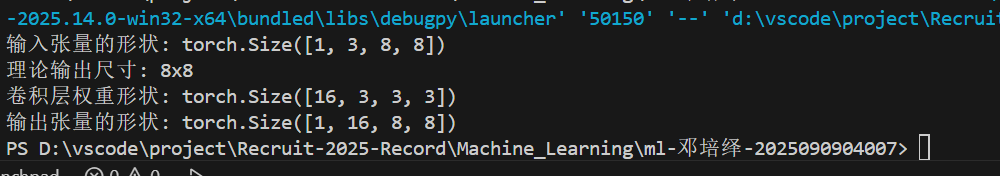
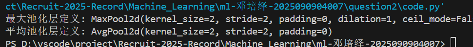
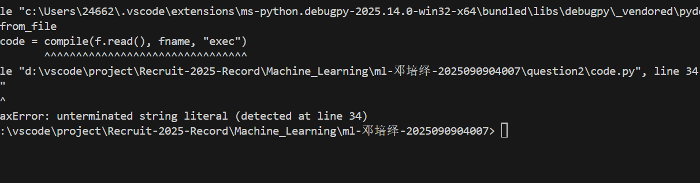

### 第一次尝试
听信教程使用torchmetric，安装后`import torch`报错，检查发现`torch.__version__`都报错，经过不断检查，发现插件torchmetric版本不兼容，删除重装无果，遂重装环境，放弃此插件。  
  
### 第二次尝试  
先构造一个卷积层，使用torch架构。  
```python
import torch
import torch.nn as nn


n,c,h,w = 1,3,8,8   #设置超参数
co,k= 16,3 
s,p=1,1


inp=torch.randn(n,c,h,w)   #构造卷积层
ho=(h-k+2*p)/s+1
wo=(w-k+2*p)/s+1
layer=nn.Conv2d(in_channels=c,out_channels=co,kernel_size=k,stride=s,padding=p)
out=layer(inp)


print(f"输入张量的形状: {inp.shape}")   #输出试验
print(f"输出尺寸: {int(ho)}x{int(wo)}")
print(f"卷积层权重形状: {layer.weight.shape}") 
print(f"张量的形状: {outr.shape}") 
```  
没有输出。  

检查发现参数没有对应。改正后依旧没有输出，重启电脑后回复正常，推测编译器的问题。  

但是没有池化层，只能输入较小的数据  
学习池化ing（学习过程在conceal里）  
### 第三次尝试
接下来设置池化层  
```python
import torch
import torch.nn as nn
maxpool=nn.MaxPool2d(kernel_size=2, stride=2)
avgpool=nn.AvgPool2d(kernel_size=2, stride=2)
print("最大池化层定义:", maxpool)
print("平均池化层定义:", avgpool)
```  
  
### 第四次尝试  
设置全连接层，并尝试进行CNN架构。
输入层：接收 3 通道（RGB）的 32x32 图像。  
第一个卷积块：  
一个卷积层（3x3卷积核，输入通道3，输出通道16）。  
一个ReLU激活函数。  
一个最大池化层（2x2窗口）。  
第二个卷积块：  
一个卷积层（3x3卷积核，输入通道16，输出通道32）。  
一个ReLU激活函数。  
一个最大池化层（2x2窗口）。  
展平层  
全连接层：  
第一个全连接层（将展平后的特征映射到120个节点）。  
一个ReLU激活函数。  
第二个全连接层（从120个节点映射到最终的10个类别）。  
```python
import torch
import torch.nn as nn

class CNN(nn.Module):
    def __init__(self, num_classes=10):
        super(CNN, self).__init__()
        
        # 定义第一个卷积块
        # 输入: 3x32x32, 输出: 16x32x32 
        self.conv1 = nn.Conv2d(in_channels=3, out_channels=16, kernel_size=3, stride=1, padding=1)
        self.relu1 = nn.ReLU()
        # 输入: 16x32x32, 输出: 16x16x16
        self.pool1 = nn.MaxPool2d(kernel_size=2, stride=2)
        
        # 定义第二个卷积块
        # 输入: 16x16x16, 输出: 32x16x16
        self.conv2 = nn.Conv2d(in_channels=16, out_channels=32, kernel_size=3, stride=1, padding=1)
        self.relu2 = nn.ReLU()
        # 输入: 32x16x16, 输出: 32x8x8
        self.pool2 = nn.MaxPool2d(kernel_size=2, stride=2)
        
        # 定义展平后的全连接层
        # 展平后的大小为 32 * 8 * 8 = 2048
        self.fc1 = nn.Linear(32 * 8 * 8, 120)
        self.relu3 = nn.ReLU()
        self.fc2 = nn.Linear(120, num_classes)

    def forward(self, x):
        # 通过第一个卷积块
        out = self.conv1(x)
        out = self.relu1(out)
        out = self.pool1(out)
        
        # 通过第二个卷积块
        out = self.conv2(out)
        out = self.relu2(out)
        out = self.pool2(out)
        
        # 展平操作
        out = out.view(out.size(0), -1)
        
        # 通过全连接层
        out = self.fc1(out)
        out = self.relu3(out)
        out = self.fc2(out)
        
        return out

# 创建实例
model = CNN(num_classes=10)
print(model)

# 创建输入数据来测试模型
dummy_input = torch.randn(4, 3, 32, 32)
output = model(dummy_input)

# 打印输出张量的形状
print("\nOutput tensor shape:", output.shape)
```
报错  
   
检查numpy版本错误，更新后依旧报错，检查第一次卷积参数写反了，  
解决，输出结果。  

